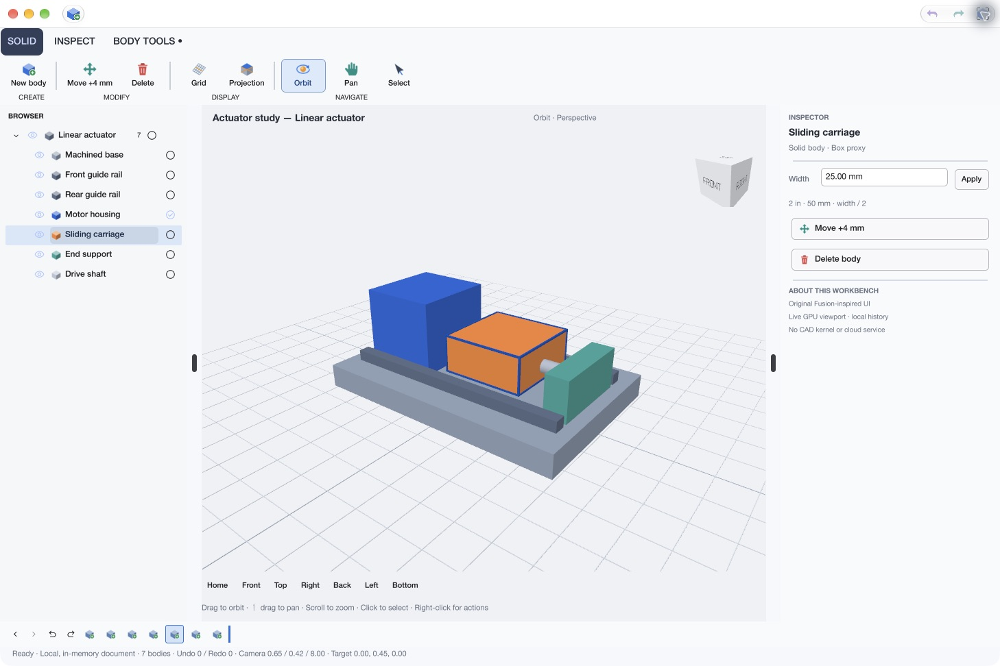
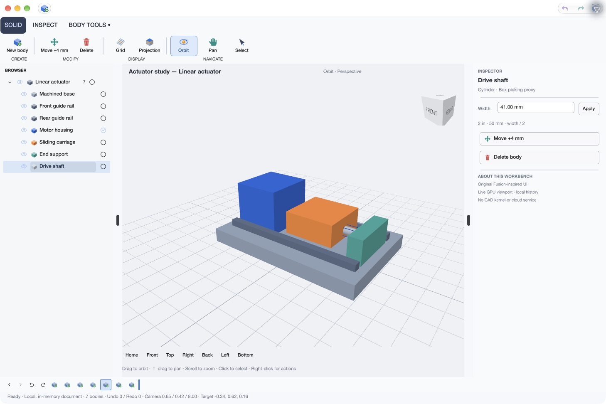
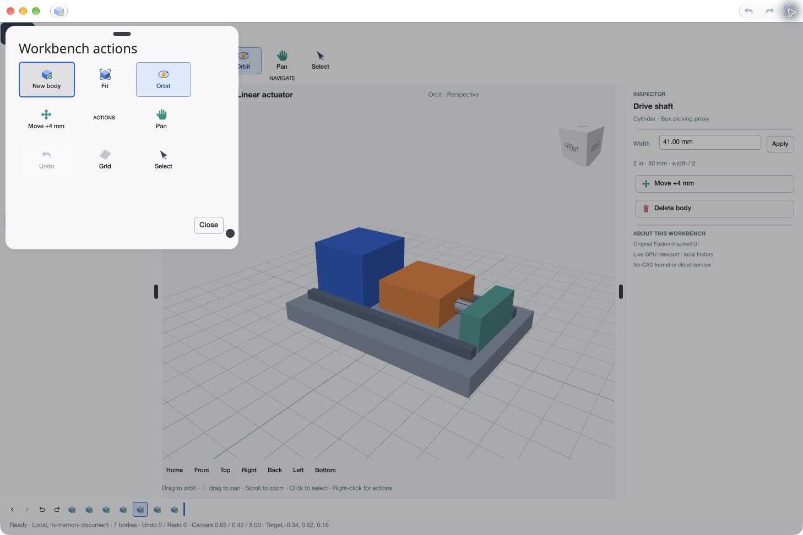

# Vellum

Vellum is a Go desktop UI framework focused on macOS look and feel. Applications
compose UI descriptions with stable widget IDs and manage state through explicit
commands, cancellable tasks, document persistence and Undo/Redo history.

The native driver uses Cogent Core and WebGPU for windowing and rendering.
Managed widgets use shared Mac typography, spacing and themes; AppKit provides
native titlebar toolbars, file dialogs, alerts, Quick Look, and Colors/Fonts panels.
Full-color toolbar and picker artwork remains untinted.

## See it in action

Original, runnable Mac apps built with Vellum's public Go APIs. These
windows use managed Mac-themed UI, native AppKit toolbars and full-color icons.
The screenshots are actual app captures; artwork and data are original fixtures.

### Forge — a design workbench

A Fusion-inspired macOS workbench built with Vellum's public Go APIs. A grouped
ribbon, model browser and property inspector surround a live 3D assembly. Full-color
icons, a native titlebar toolbar and a compact feature strip complete the workspace.



Orbit, pan and zoom the assembly, select bodies, click the orientation cube,
and edit dimensions using expressions such as `2 in` or `width / 2`. Creation,
movement, resizing, visibility and feature-history edits support Undo/Redo.
Active tools stay visible, and selection outlines preserve each body's material.

| Body inspection | Context actions |
| --- | --- |
|  |  |
| Cylindrical shaft display with its box picking bounds outlined. | A focus-scoped action panel with consistent macOS-style colors. |

Forge is available in the current development checkout and matching newer
private SDK bundles; the `v1.0.0` source tag and published build13 SDK do not
contain it. From a clone of this repository, run:

```sh
git switch main
git pull --ff-only
./drivers/cogent/prepare.sh
. ./drivers/cogent/env.sh
(cd examples/forge && go run .)
```

See the [Forge guide](examples/forge/README.md) for controls and private packaging,
the [reusable workbench APIs](docs/fusion-workbench.md) for integration, and
[screenshot details](docs/screenshots/README.md#forge-workbench) for capture identities.
The viewport is experimental and uses box and capped-cylinder primitive picking. The demo supports native Save/Open and recovery, multi-selection, axis move/resize
handles with snapping and numeric deltas, and persistent workspace customization.
It has no CAD kernel. It is
source/private-build work and is absent from the six published build13 apps.

### Forma — a space for ideas

A poster studio combining retained GPU geometry, an image layer, layer selection,
a color/size inspector and command-based Undo/Redo. Pan, zoom and fit the artboard.


Run: `(cd examples/showcase && go run ./cmd/forma)`

### Luma — a library of light

An image browser with a selectable filmstrip, collections, favorites, search,
nondestructive color variants and a histogram sampled from the displayed image.
Every landscape is generated locally in Go.


Run: `(cd examples/showcase && go run ./cmd/luma)`

### Pulse — a clearer signal

A dark telemetry explorer pairing retained GPU charts with a virtualized,
indexed table of 1,024 fictional service records. Filter, sort, inspect a service
or advance the repeatable sample data. No monitoring service is contacted.


Run: `(cd examples/showcase && go run ./cmd/pulse)`

Prepare and source the driver environment using the Quick start below first.
See the [showcase guide](examples/showcase/README.md) for controls, private app
packaging and limits, and [screenshot reproduction](docs/screenshots/README.md)
for source identities and capture details. These examples reset on launch and use experimental GPU surfaces. The Forge
track adds reusable preview controls while preserving the released v1 API
signatures and existing release qualification.

## Current status

**Latest tagged source release: [v1.0.0](https://github.com/dshills/vellum/releases/tag/v1.0.0).**
This release provides the Go framework source, macOS examples and build tools
for personal use. Read the [release notes](release/notes/v1.0.0.md) for highlights
and the [stable API contract](specs/stable-api.md) for compatibility guarantees
and experimental exclusions. See the showcase apps above for current UI examples.

Build native apps from the tagged checkout using Quick start below. GitHub's
source ZIP/tar archives are checkout source, not prepared SDKs or installed apps;
run the pinned dependency preparation step before native builds. The separately
versioned native driver is consumed through the checkout's local replacements.
This release creates the root `v1.0.0` tag; it does not add native-module tags.

**Prepared macOS downloads: [macos-v1.0.0-build13](https://github.com/dshills/vellum/releases/tag/macos-v1.0.0-build13).**
The release contains the SDK, Vellum Notes, Mac Widgets, Mac Shell, Forma, Luma
and Pulse, all built from green source `64bf9cf`. Every app uses that same SDK
and includes the window-exposure repair. The separate packaging tag matches
that source; the original `v1.0.0` Go source tag stays at `4b42fb8`.

Download the [prepared SDK](https://github.com/dshills/vellum/releases/download/macos-v1.0.0-build13/vellum-v1.0.0-build13-darwin-arm64-sdk.tar.gz)
and [SHA256SUMS](https://github.com/dshills/vellum/releases/download/macos-v1.0.0-build13/SHA256SUMS),
or choose any of the six apps on the release page. Verify the matching named
checksum before extraction. GitHub download filenames use dots in place of spaces.
Apps are **ad-hoc signed and unnotarized**; downloaded-quarantine launch is
unqualified. See the [publication record](docs/reports/macos-v1-build13-publication/README.md)
for verified download hashes and the [Mac guide](docs/macos-v1.md) for use/support.
The older alpha.3 preview and private deliveries retain their original identities.

Native acceptance covers the recorded Apple Silicon macOS host. Human
IME candidate behavior and VoiceOver usability remain unqualified, as do other
macOS/hardware/display configurations and Windows/Linux. Wayland is unsupported.
Replay, automation, diagnostics and broader GPU/workbench workloads remain
experimental. See the [support matrix](docs/macos-v1.md#supported-api-contract).

### Private Documents evaluation

The internal **build24-b9212489afc9** candidate (minimum macOS 27.0) now has
recorded native document-workflow checks on macOS 27.2: exact Unicode Save/Open,
Find/Replace with settled keyboard Undo/Redo, coordinated Save A / Cancel B Quit,
normal restoration, and recovery of an unsaved note after a controlled interruption.
Focused offscreen race tests cover the corresponding routing and persistence
contracts. See the [acceptance records](docs/reviews/document-priorities/) for
scope, evidence and default Prism reviews.

For an existing verified private installation, run from the checkout root:

```sh
python3 -B scripts/daily-documents.py --check-only
python3 -B scripts/daily-documents.py
```

The launcher checks the pinned candidate, installed bytes/signatures and host,
then opens a separate persistent evaluation workspace. See the
[daily-use guide](docs/daily-use/README.md) and [issue log](docs/daily-use/ISSUE-LOG.md).
Multi-day use remains to be evaluated. These scoped checks do not qualify every
control, physical pointer geometry, IME or VoiceOver, and do not change the public
build13 downloads or the support matrix. Feature scope and installed candidate
bytes remain frozen.

## What is available

- **Mac controls and themes:** text/search fields, prose editors, selectors,
  steppers, sliders, calendars, lists/outlines, inspectors, sheets and popovers.
- **Toolbars:** full-color icons, multiple sizes and display styles, overflow,
  spacers, customization and persistence; native titlebar toolbars can have
  independent commands and availability for each window.
- **Content widgets:** controlled checklists, file/folder fields, date ranges,
  embedded PDFKit documents and AVKit media with original-color posters on macOS.
  [Contracts and native limits](docs/controls.md).
- **Application services:** multiple windows, command menus and shortcuts,
  clipboard, file dialogs, native panels and accessibility integration.
- **Application state:** commands, bounded Undo/Redo, document persistence,
  interrupted-session recovery and cancellable background work.
- **Data and graphics:** virtual grids/trees, dockable workbench panels,
  same-window palette placement, retained 2D scenes, images, meshes and custom 3D views.
- **Testing tools:** offscreen routing tests, deterministic replay and opt-in
  local semantic automation, with separate physical/native acceptance.

Browse the [widget demo](docs/mac-widget-demo.md),
[control contracts](docs/controls.md), [content integration examples](docs/mac-content-integration.md), [app-shell APIs](docs/macos-app-shell.md),
and [framework contract](specs/framework.md) for behavior and subsystem limits.

## Quick start on macOS

Install the Go version declared in [go.mod](go.mod), Python 3, Git, `patch`, and
Xcode Command Line Tools. Native applications require a supported GPU; current
personal-use testing targets Apple Silicon macOS.

```sh
git clone --branch v1.0.0 --depth 1 https://github.com/dshills/vellum.git
cd vellum

# Prepare pinned native sources and the local build environment.
export VELLUM_CACHE_DIR=/tmp/vellum-go-cache
./drivers/cogent/prepare.sh
. ./drivers/cogent/env.sh

# Explore Mac widgets with an AppKit titlebar toolbar and system appearance.
(cd drivers/cogent && go run ./cmd/gallery -mac-widgets -native-titlebar -mac-system-appearance)
```

Preparation verifies dependency sources and applies driver-owned patches. The
native driver and example modules use explicit local replacements. Build from
the checkout with this workflow, or use the independently extracted SDK route in
the [Mac guide](docs/macos-v1.md#consume-the-published-sdk).

## Example applications

After preparation, run these commands from the repository root with
`drivers/cogent/env.sh` sourced. Each command launches a separate application.

| Example | Run | Demonstrates |
| --- | --- | --- |
| [Forma](examples/showcase/README.md#forma--design-studio) | `(cd examples/showcase && go run ./cmd/forma)` | Original poster, retained GPU canvas, layer inspector and Undo/Redo |
| [Luma](examples/showcase/README.md#luma--image-library) | `(cd examples/showcase && go run ./cmd/luma)` | Original image assets, filmstrip selection, collections, color variants and sampled histogram |
| [Pulse](examples/showcase/README.md#pulse--telemetry-explorer) | `(cd examples/showcase && go run ./cmd/pulse)` | Dark theme, retained charts and virtualized service fixtures |
| [Mac Widgets](docs/mac-widget-demo.md) | `(cd drivers/cogent && go run ./cmd/gallery -mac-widgets -native-titlebar -mac-system-appearance)` | Frozen widget catalogue, scoped themes, full-color icons, toolbar customization and native panels |
| [Notes](examples/macapps/notes/README.md) | `(cd examples/macapps && go run ./cmd/notes)` | Proportional prose with emoji, folders/search, native toolbar and menus, local Save/Open, recovery and Undo/Redo |
| [Documents](docs/daily-use/README.md) | `(cd examples/macapps && go run ./cmd/documents -data-dir /absolute/private/workspace)` | Two independent notebooks, native per-window commands, coordinated Quit, restoration and recovery |
| [Native shell](examples/macapps/cmd/macshell/main.go) | `(cd examples/macapps && go run ./cmd/macshell)` | Two windows with independent native toolbar commands and disabled states |
| [Drawing app](examples/placement/README.md) | `(cd examples/placement && go run .)` | Palette placement, pan/zoom, selection, editing, layers, Save/Open and Undo/Redo |
| [Mac starter](examples/personal-mac/README.md) | `(cd examples/personal-mac && go run .)` | Small public-API consumer with a full-color native toolbar and system appearance |
| [Hello](examples/hello/README.md) | `(cd examples/hello && go run .)` | Minimal public-API application |
| [Calculator](examples/macapps/calculator/README.md) | `(cd examples/macapps && go run ./cmd/calculator)` | Fixed-size calculator with arithmetic and keyboard input |
| [Weather](examples/macapps/weather/README.md) | `(cd examples/macapps && go run ./cmd/weather)` | Sample cities, forecasts and unit selection |
| [Reminders](examples/macapps/reminders/README.md) | `(cd examples/macapps && go run ./cmd/reminders)` | Public checklists, scheduled date ranges, details and Undo/Redo |
| [Workbench](drivers/cogent/cmd/workbench/) | `(cd drivers/cogent && go run ./cmd/workbench)` | Docking and composed UI |

The macOS-style examples approximate familiar application layouts and use sample
data; they do not connect to Apple's services. Notes stores its local notebook in
`~/Library/Application Support/Vellum Notes`; use `-data-dir /absolute/test/path`
for a separate test notebook. It remains a plain-text app without iCloud or rich
attachments. See its guide for storage, locking and recovery behavior.

The drawing app supports moving/resizing, grouping, alignment/distribution,
layer reordering and SVG export. Placement stays in one window, groups are flat,
and fills use opaque RGB. Rotation, nested groups and SVG import are not implemented.
The [example index](examples/README.md) covers additional data, graphics and
experimental automation consumers.

## Build your own application

Create a separate Go application module after preparing this checkout:

```sh
python3 scripts/new-app.py ../my-vellum-app --module example.com/my-vellum-app
(cd ../my-vellum-app && go test ./... && go run .)
```

The generated module uses replacements pointing at this checkout. The private
SDK supports the same generator with replacements contained inside its extracted
archive; no repository checkout is needed. Do not run `prepare.sh` over the SDK's
pinned native capsule.

The generated starter contains ordinary public-API UI and no GPU benchmark
flags or direct Cogent Core imports. Use the [Personal Mac starter](examples/personal-mac/README.md)
for a native toolbar example; `examples/hello` retains diagnostic benchmarks.

Start with [building a macOS app](docs/building-macos-apps.md), the
[application tutorial](docs/tutorials/building-an-app.md),
[shared Mac presentation](docs/mac-presentation.md), and
[native shell APIs](docs/macos-app-shell.md). The [SDK contract](specs/sdk.md)
describes packaging and relocation.

## Build your own Mac application

The [application guide](docs/building-macos-apps.md#complete-document-starter)
covers two independent starter profiles. The default is a minimal utility;
`--template document` adds an app-owned prose notebook, Save/Open/Save As,
recovery, dirty-close decisions and Undo/Redo through public APIs. Document
apps launch normally with their own private Application Support storage and
retain an explicit `-data-dir` override for isolated testing.

The [matching private SDK/app recipe](docs/private-consumer-bundle.md) builds
Forge, Measure Pad, the two-window Documents diagnostic, Document Starter and
Notes from one extracted SDK. These newer private bundles are separate from the six
published build13 apps. The offscreen SDK consumer CI checks both starter
profiles, while native UI observations remain separate. Current checkpoints
use internal code reviews. See the [current document-workflow handoff](docs/mac-document-workflows-handoff.md)
for the [indexed private candidate](release/private-macos-candidate.json), historical
file compatibility, producer preflight and historical desktop-check deferrals. The
[newer Documents acceptance records](docs/reviews/document-priorities/) supplement
that historical record with scoped native workflow results.
The index records actual OS requirements; static checks extend no support matrix.

## Verification

The release's automated checks include portable race/vet, focused native
routing/lifetime regressions, 20 repeated grid/tree cancellation checks, an
independent SDK consumer and a generated starter build. App ZIP extractions and
installed launch copies have strict signature and signed-byte verification.

Separate physical checks cover Notes pointer selection, text/history, native
file-panel focus restoration, per-window toolbar isolation, disabled-action
refusal, gallery field targeting and normal saved-notebook relaunch. These checks
do not establish human IME/VoiceOver usability or every workload/display. The
[acceptance report](docs/reports/macos-v1/README.md) distinguishes final results,
reused verification and the initial defects that were corrected. Performance
policy and the rendering backend remain unchanged.

## Repository layout

| Path | Purpose |
| --- | --- |
| `app/`, `ui/`, `canvas/`, `placement/` | Public application, UI and canvas APIs |
| `command/`, `history/`, `document/`, `editor/` | Commands, persistence and editing models |
| `tasks/`, `execution/`, `virtual/`, `workbench/` | Background work, scheduling, data views and docking |
| `replay/`, `automation/` | Experimental replay and local semantic automation |
| `drivers/cogent/` | Native driver module; executable tools under `cmd/` |
| [examples/](examples/README.md) | Independent application and contract modules |
| [docs/](docs/README.md), [specs/](specs/README.md) | Guides, contracts, research and historical evidence |
| `scripts/`, `release/`, `prototypes/` | Build/packaging tools, notices and isolated historical experiments |

The root module, `github.com/dshills/vellum`, uses only the standard library.
Native dependencies belong to `github.com/dshills/vellum/drivers/cogent`.
Historical reports have a separate module boundary and stay out of framework
module downloads. See the [layout guide](docs/repository-layout.md).

## Development and checks

From the repository root:

```sh
go test -race ./...
go vet ./...
```

Each driver/example module is checked separately. For example, after preparation:

```sh
(cd examples/placement && go test -race -tags offscreen ./...)
(cd examples/macapps && go test -race ./...)
```

Offscreen tests do not open desktop windows. Live input, accessibility, GPU and
display checks have separate verification requirements. The full prepared-repo
workflow is `scripts/check.sh`; see [CONTRIBUTING](CONTRIBUTING.md) and the
[development guide](docs/development.md) before running native campaigns.

## License and distribution

Vellum's own code is [MIT licensed](LICENSE). Third-party components retain their
original licenses and notices. The approved alpha.3 distribution decision covers
that exact payload and notice bundle. The owner also approved the v1 baseline
[audit](release/macos-v1-distribution-audit.json) and the exact
[build13 publication](release/macos-v1-build13-publication.json). The prepared
SDK and six apps are now public developer downloads with original notices and
verified checksums. This approval covers only the named payload; future native
assets, signing identities and notarization require separate decisions. See the
[release contract](specs/release.md) and [release metadata](release/version.json).
