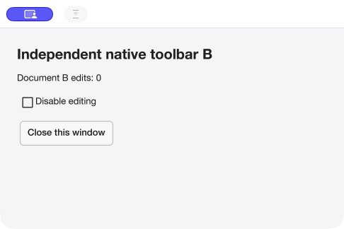
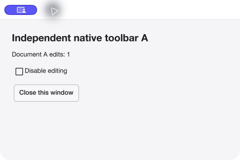

# Mac Shell contrast repair and replacement verification

**The fixed-light contrast defect is corrected and verified in the replacement.**
Both windows have readable dark labels on a light surface, including on the
observed dark-appearance desktop. Feature/API, backend and release/performance
policy are unchanged. The optional fixture still has a separate captured-window
exposure discrepancy described below; it remains out of the proposed upload set.

## Exact change and source

Fix commit: `917d4c0fe185a9bc0294503623da48ec7352df42`.
Only `examples/macapps/cmd/macshell/main.go` changes executable behavior. Its
existing `ui.MacTheme(false)` is shared by the driver and root background; both
native windows explicitly select `app.AppearanceLight`. No system preference is
changed and no adaptive-theme feature is introduced. Per-window commands, PNG
artwork and lifecycle code are unchanged. [Fix review/checks](../../reviews/macos-shell-contrast/README.md).

The replacement builds from an isolated verified SDK copy (8,856 file identities),
with exactly that one product source file replaced by its committed bytes. All
92 module identities/origins and the source-built native archive
`786aaad8bd66fa5f7c0dd395c57ff7454838387c8aae29f33f3c6652ecec4883` are unchanged.
The actual external link map selects that archive; its full hash and matching
lines are retained. No other SDK/app candidate was rebuilt or overwritten.

## Replacement identity

- App version1.0.0, **build11**; previous held package was build10.
- Source executable SHA256: `3d68a0588f8d3aeb6f3f66a40641fb66bc950ce3b86d2e23eca8aa65b47bc1a2`.
- Signed executable SHA256: `dad56574b273416505f2e154664c499dd48e0c28a975cfdfe5af1a7927ab4691`.
- Notice inventory SHA256: `a142dd25f165bc50d5900b5060c5ead16ed44dc7ef8eb1d77d3e0667ba485eba`.
- ZIP SHA256: `9c5f9fa7f7afc7df5345ebfa170d8ff8257709577ce387671de313f4542425f4`.

The old/new pre-sign binary, inventory and archive identities are separately
recorded in [the package record](replacement-package.json). Its runtime outcome
is updated after checks and points to replacement-native.json. The unmodified
pre-launch producer receipt (runtime_result=not-yet-run) remains inside the raw
evidence archive; it is a capture-time snapshot, not final runtime acceptance.
The delivery manifest also records the completed checks and unresolved exposure
discrepancy. The 418 original
notice files, component references and collection labels are identical; only
inventory.artifact_sha256 changes to bind the new executable. The old inventory
correctly rejects this replacement executable. No new third-party material or
new rights grant is asserted. Historical exact-payload owner approval is unchanged
and is not relabeled as approval of these new archive bytes.

The unchanged public app producer accepts the existing release/native-audit and
clean-source guards with the exact new binary-bound notices. The manifest records
private_build=false, native_distribution_audit=approved, ad-hoc signing and
notarized=false; its audit declaration refers to the unchanged native/dependency
payload. This reviewed first-party correction and new artifact identities are an
explicit delta. Final-asset publication remains separately unapproved.

The durable replacement is in the research workspace's
`deliveries/macos-shell-contrast-20261027/`, with README, SHA256SUMS and manifest.
The original seven archives and their prior checksum lists remain unchanged.
Do not replace the old Shell ZIP without updating its filename/location/hash
references. No asset, tag, merge or signing identity was published/used here.

## Focused checks and native observations

Final Shell offscreen executable compilation/race wiring and vet pass. Existing
per-window policy ownership/validation and unsupported-native-chrome refusal
regressions pass. These are supporting automated checks; they do not emulate
native decoration. No broad qualification/performance campaign was rerun.

The new ZIP is extracted and strictly signature-verified, then copied without
extended attributes to an isolated launch path. Native accessibility actions and
unedited captures establish:

- B starts at0, its toolbar increments only B to1. Disabling editing makes B's
  native toolbar button unavailable; reenabling restores it.
- Closing B leaves A live at0. A's own toolbar increments A to1 and repaints A.
- B's initial content and A's post-command content visibly have correct contrast.
- Closing the last window retires the process, in both the main check and one
  bounded exposure control. No uncollected process exit code is claimed.
- After closure, strict signature, signed executable/manifest hashes, ZIP hash
  and all418 binary-bound notices still verify. All prior seven archive hashes
  remain unchanged.

[Native result](replacement-native.json) and [indexed raw evidence](evidence-index.json)
include all AX states/captures. These checks use native accessibility actions,
not physical mouse verification, human accessibility qualification or download/
quarantine acceptance. The current support and ad-hoc/unnotarized limits remain.

## Separate remaining exposure/capture discrepancy

After closing B, accessibility identifies A at0 while the capture retains B's
previous rendered content. A native Raise alone still captures B content in a
second bounded run. Executing A's own toolbar command produces correct A1 content.
Both windows' captured backgrounds/text have corrected contrast throughout.
The first `a-initial`/`a-current` captures are retained as discrepancies, not
misrepresented as correct A0 rendering. Only `a-edited.jpg` supports the A image above.

This evidence does not distinguish a presentation/exposure defect from a
computer-use capture issue. Record it as **unresolved**; full native exposure
acceptance is not claimed. The smallest next investigation is an app-restricted,
independent window-frame observation before and after expose/repaint, without
editing user data or changing global appearance. Do not expand this focused
contrast repair into a backend campaign. The optional fixture stays held from
public recommendation until the discrepancy is resolved or independently classified.

The prior [publication packet](../macos-v1-public-packaging/PUBLICATION_PACKET.md)
continues to recommend the unchanged SDK plus five other apps. Historical
contrast-failure evidence remains valid for its older binary. This replacement
resolves that contrast defect; no upload approval is implied for either ZIP.
