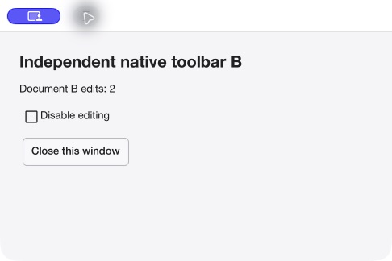
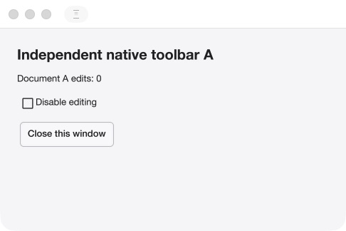

# Mac Shell window-exposure repair — verified build12

**Build12 passes the bounded window-exposure acceptance checks.** Closing B,
including an edited B2, reveals A's own unchanged A0 content without an action in
A. Both native and application Close paths pass. Native Raise also preserves A0.
The earlier contrast repair remains intact. Features, public APIs, backend,
experimental rendering/pacing and release/performance policy are unchanged.

## Cause and correction

The native path requested paint on focus/show, but the clean-scene fast path
could skip composition. Raise (used to restore a survivor after sibling closure)
also did not request its own presentation. Thus a native destination requiring
restoration could remain stale until a model edit made scene content dirty.

[Checksum-pinned stage0108](../../../drivers/cogent/native/patches/exposure/README.md)
marks one per-window presentation request on Raise/focus/show and consumes it only
after visibility and native ownership admit composition. A hidden pass preserves
one request. The existing paint coalescer handles repeated/in-flight requests;
normal unchanged idle still skips work. No timer loop, value edit, command,
new backend or pacing option is used as a workaround.

Source commit: `9961ecf1b6b2c3f6582694480ff163756da706ed`.
The new stage changes `core/renderwindow.go` and adds an offscreen regression
file. Build11's Shell source/appearance/artwork is unchanged. Existing window
lifetime and registration guards remain in use. [Prism/test checkpoint](../../reviews/macos-shell-exposure/README.md).

## Evidence and its limits

The same real retained-scene/software-compositor tests fail on the prior path
and pass on the repair. They overwrite only destination pixels, then restore the
owner's cached scene without any model/scene edit through close-other, Raise,
focus and show. Hidden/in-flight and repeated requests are coalesced/retained;
idle stays idle. Related busy/display-admission, concurrent focus/retirement,
Core vet and patch-pin checks pass. Unittest emits its successful one-test
`OK` summary on stderr; public packaging emits codesign’s expected
`replacing existing signature` message during requested ad-hoc signing. Both
commands exit0; extracted and post-launch strict signature checks also pass.
Stderr silence is not used as a success criterion. The normal preparer reproduces the exact
tested output hashes and rejects drift before creating the new regression file.

Two fresh bounded live controls of unchanged build11 happened to pass. These
passes do not erase the earlier failed captures or establish that the capture
service caused them. The deterministic missing-presentation gap is established
and repaired; it is not claimed as proof of the sole cause of every old capture.

The exact ZIP-extracted build12 was observed in three independent launches:

1. Native close of B0 exposes correct A0; native Raise still shows A0.
2. Native close of visibly distinct B2 exposes correct A0, with no action in A.
3. The application Close button exposes correct A0; A's own toolbar then makes
   exactly one edit to A1. B's lock disables/reenables its native toolbar.

Each run ends with normal last-window closure. The final exact executable process
path is absent. After closure, strict signature, signed binary/manifest and ZIP
hashes and all418 original notice files still verify. The previous seven public
candidate archives plus build11 remain byte-identical. [Native result](replacement-native.json)
and [indexed raw evidence](evidence-index.json) retain AX states, unedited captures,
expected baseline failures and actual command logs. These are native AX/capture
observations, not physical-pointer, human IME/VoiceOver, other-host/platform,
performance or downloaded-quarantine qualification. No exit code was fabricated.

## Exact replacement and distribution delta

- Version1.0.0 **build12**, replacing held build10/build11 only.
- Source executable SHA256: `fb3c04dd7b1bc728c48f6b0a99feb6bb77108a0ec31fa47a8334cbb9f6e5125c`.
- Signed executable SHA256: `d55e9cf11ade94f2d496e171a5aa7da349891852d5ce104ddb307cd86702b125`.
- Notice inventory SHA256: `a14acf8b5e5eb80e3782198c5af56f8a032588d95d87d42bab8ca521c8f46c44`.
- Final ZIP SHA256: `da83c7d548c9f669bb6e24ced7a1790f287a3df4f000e570d5cd2d2c78cb8cd1`.

The build starts with the verified prior SDK plus the unchanged build11 fixture
and the exact committed stage0108 prepared-Go outputs. Relative to build11 only
one runtime Go source changes. All92 module identities/versions, selected asset
bytes, original license/notice declarations and native archive 786aaad8… remain
unchanged. **Prepared Core Go bytes do change**; they are not described as an
unchanged dependency payload. The actual link map selects the same native archive.
The SDK itself and other app downloads were not regenerated and do not acquire
this new patch. Updated source preparation includes it for future builds.

All 418 notice bodies/component references remain identical; only their inventory's
artifact_sha256 is rebound to the new executable. The old binding correctly
rejects the new executable. The [package record](replacement-package.json) pins
all old/new hashes and the exact prepared-Go patch. Its final runtime outcome
references replacement-native.json. The pre-launch timing/status
snapshot in raw evidence records its capture-time not-yet-run state.

The unchanged public producer passes its clean-source/native-audit and exact
notice guards; manifests say private_build=false, native_distribution_audit=approved
and notarized=false. Sealed target_runtime=unverified retains its producer
meaning; this separate report records the bounded observations. Those declarations are not approval to upload this
new archive. Historical exact-payload audit approvals and the v1.0.0 tag remain
unchanged; the new first-party prepared-Go source delta is explicit and reviewed.
No rights grant or owner approval of these new exact ZIP bytes is inferred.

Durable files: research workspace `deliveries/macos-shell-exposure-20261027/`.
Use [SHA256SUMS](SHA256SUMS), never substitute a loose temporary app directory.
The replacement can now join the unchanged SDK and five apps in the separately
proposed [publication set](PUBLICATION_SET.json). Both older Shell ZIPs remain
held historical artifacts; this checkpoint supersedes their hold only for build12.
Ad-hoc signing/unnotarized limits remain disclosed. No upload, tag movement,
merge, signing identity, notarization, notebook or global preference change occurred.
