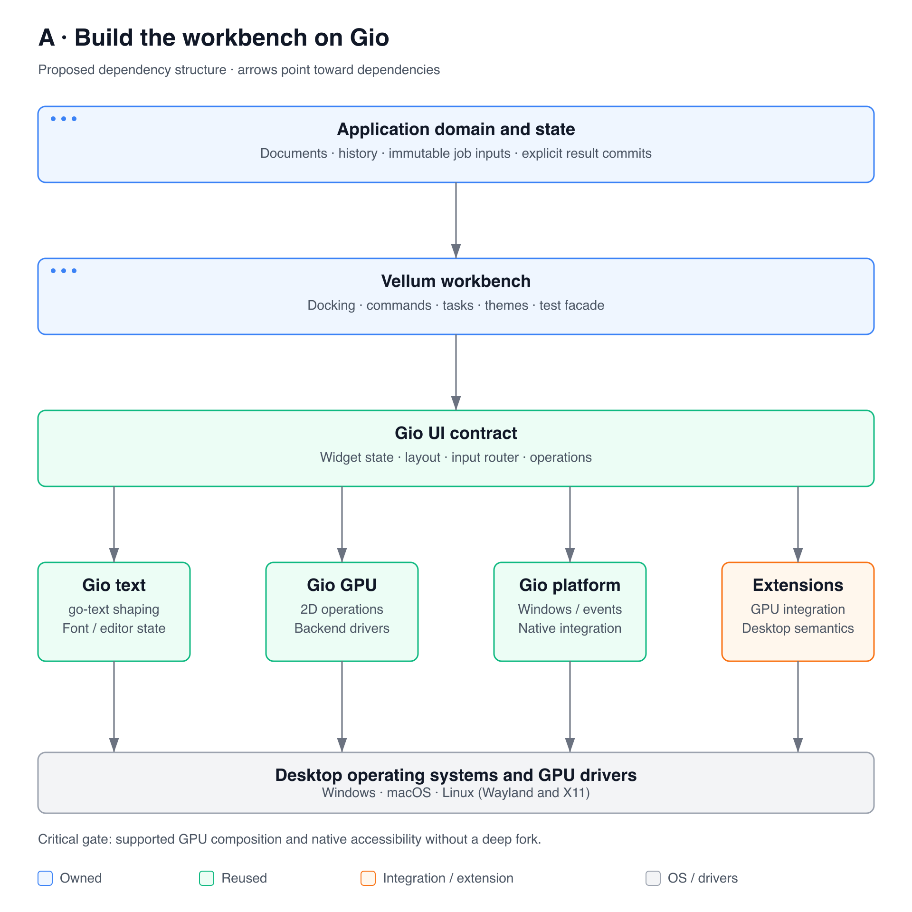
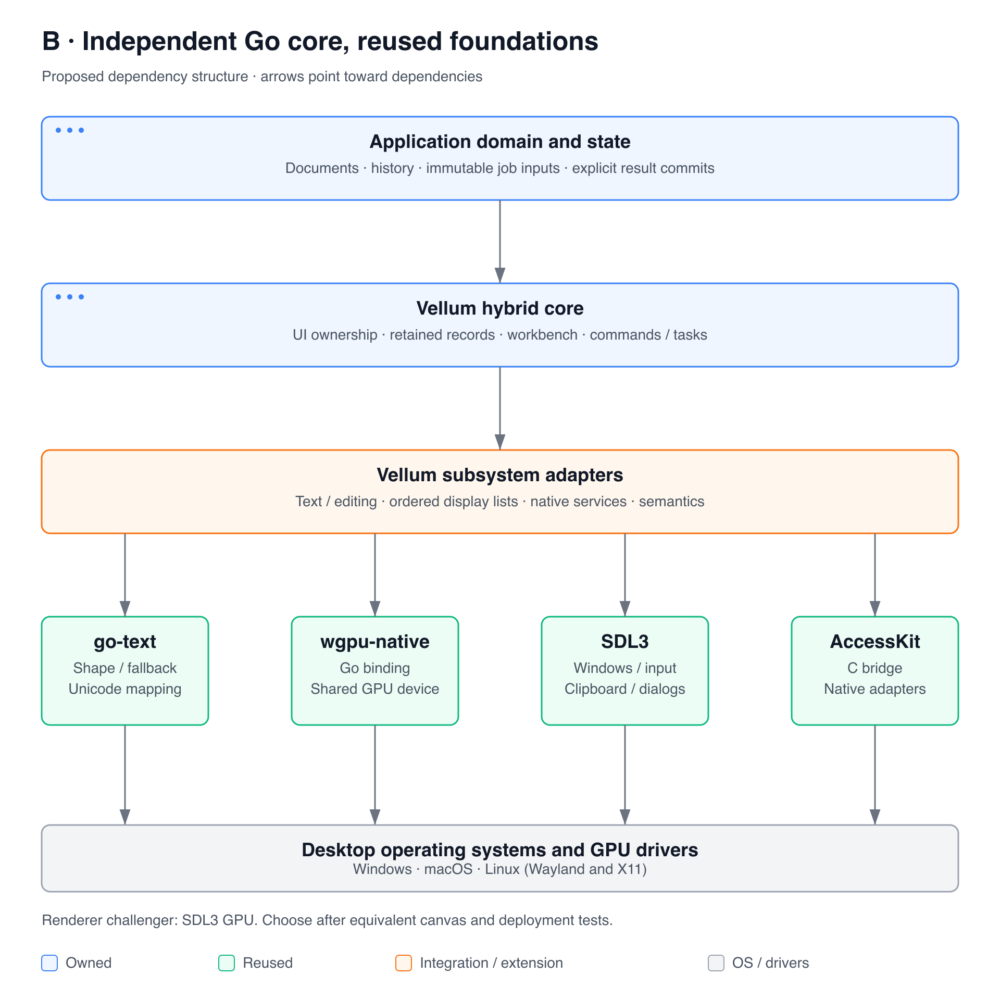
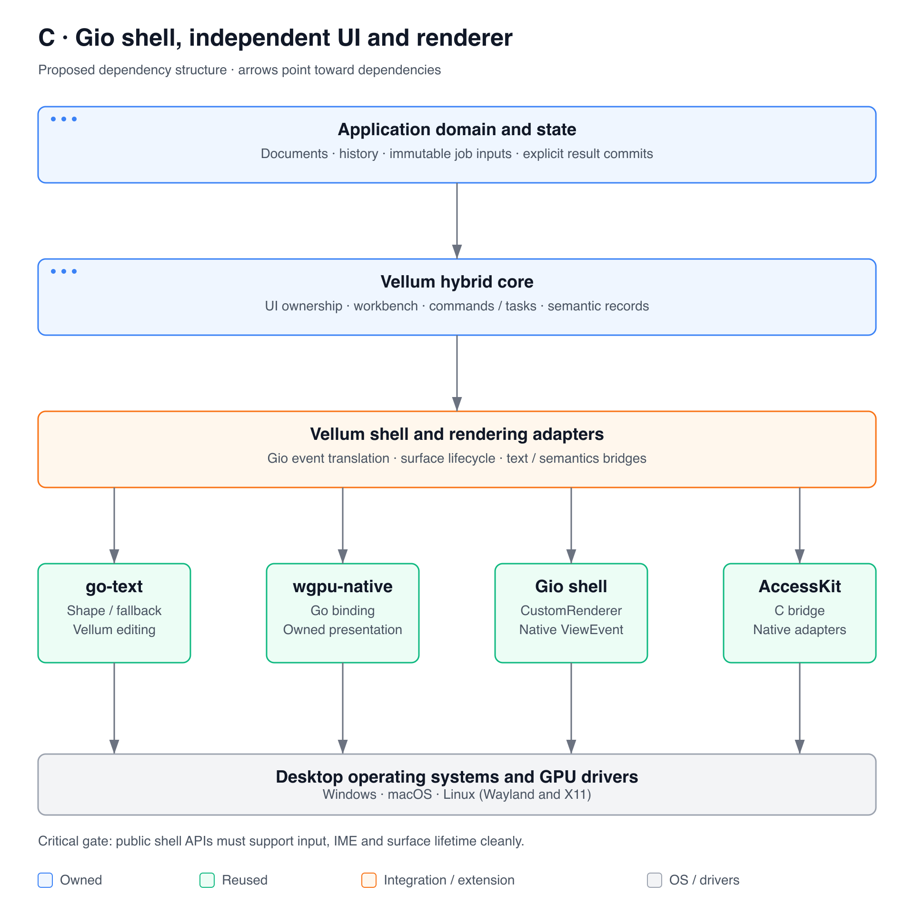
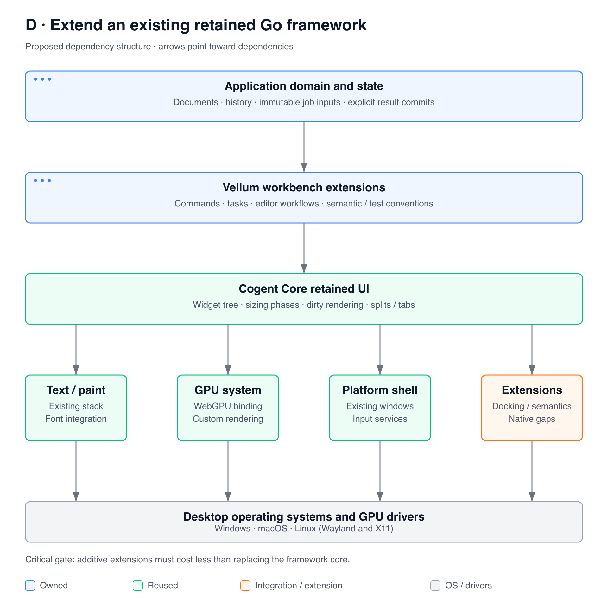

# Architecture options

Research date: 9 October 2026. All designs below are proposals, not implemented systems. Source evidence is in [RESEARCH.md](RESEARCH.md); hard validation gates are in [PROTOTYPE_PLAN.md](../../specs/prototype-plan.md).

## Shared requirements

Every option must keep the domain model independent of the UI, support cancellable work with revision-checked commits, expose a common command path, virtualize large views, and provide semantics suitable for both accessibility and testing. Every option must support custom GPU canvases without mandatory per-frame CPU readback. Desktop accessibility and correct multilingual editing are release gates.

The diagrams show dependency structure. Blue components are Vellum/application work, green components are reused, amber components require integration or extension, and gray components are OS/driver facilities. Arrows point toward dependencies. SVG and PNG exports are provided under `docs/assets/`.

## A. Professional workbench built directly on Gio

[SVG](../assets/architecture-a.svg)

**Composition.** Application model and commands → Vellum editor widgets/docking/task layer → Gio layout/widget/input/ops/text → Gio GPU and platform drivers. Extend platform semantics and custom rendering only where the gate experiments establish a viable supported path.

**Reuse.** Gio owns the window lifecycle, text integration, event routing, UI operations, ordinary 2D rendering, and its backend family. Vellum builds professional controls, command surfaces, task conveniences, docking, theme tokens, and a testing facade. Go-text remains underneath Gio rather than being independently integrated for normal widgets. [Gio frame contract][GIO-APP], [renderer][GIO-GPU], [text][GIO-TEXT]

**Advantages.** Lowest amount of new UI infrastructure; already Go-native; naturally composable state structs; low-allocation operation storage; existing window/input/text/headless components. A fast path to proving product-level workbench value.

**Disadvantages and inherited constraints.** Custom widgets and layout participate in Gio's ops/context model. Public GPU APIs do not expose a general graphics/compute device; internal driver extraction is not ordinary package reuse. Existing semantic roles are narrow and desktop screen-reader adapters were not found in the inspected drivers. External DnD/native menu/dialog needs remain. A broad fork to solve these gaps would undermine the principal benefit of this option. [GPU boundary][GIO-DRIVER], [semantics][GIO-SEMANTIC], [Wayland drop handlers][GIO-WAYLAND]

**Performance implications.** Good starting architecture for controls and 2D drawing; virtual List and text/path caches reduce work. A custom 3D/image renderer must prove shared-device/texture composition and bounded synchronization. Rendering offscreen in another device and reading it back every frame fails the target requirement. No measured advantage over B/C is claimed.

**Platform implications.** Gio controls the native shell and much of event translation. `go build` retains Gio's platform dependencies. Native screen-reader work may require upstream extensions or an external bridge that needs richer semantics and native handles. Assess these changes with maintainers before accepting a permanent fork.

**Maintenance burden.** Low-to-medium if supported APIs suffice; high if core ops, GPU, semantics and all desktop drivers need patching. Pin Gio and run adapter tests on upgrades.

**Choose A when:** the GPU and accessibility prototypes pass through small maintainable changes, and the workbench can deliver its value primarily above Gio. **Reject A when:** arbitrary GPU views require sustained internal forks or platform gaps consume the same effort as owning a narrow shell.

## B. Independent hybrid Go core with reused native foundations

[SVG](../assets/architecture-b.svg)

**Composition.** Application model/commands → Vellum UI owner, widget/layout/semantic records, editor controls, task and test layer → go-text, renderer adapter, platform adapter, accessibility adapter. Initial experiment: SDL3 window/input services; wgpu-native through the maintained Go binding; AccessKit through a narrow C bridge.

**Reuse.** Go-text for shaping/fallback/segmentation; SDL3 for platform operations; wgpu-native for Metal/Vulkan/D3D12-class backend work; AccessKit for native accessibility adapters. Normal app code uses Go packages and functions. FFI stays behind resource-owning adapters. [go-text][GT-SHAPING], [SDL text contract][SDL-KEYBOARD], [wgpu binding][WG-DEVICE], [AccessKit bridge][AK-CREADME]

**Build.** The UI declaration/state contract, constraints and retained layout records, focus/input routing, text editing integration, ordered 2D display lists, a modest UI renderer, editor widgets, docking, command/task APIs, semantic schema, and test harness. This is substantial framework work even though GPU backends and shaping are reused.

**Advantages.** Direct control over professional-workflow requirements and stable semantic identity. Can share the renderer's GPU device with application canvases. Native services, task state, commands, and tests can use one architecture. The public API need not expose SDL, AccessKit, wgpu, a DSL, or a large reactive object model.

**Disadvantages.** Highest new core implementation burden. Correct event routing, selection, text editing, cache invalidation and accessibility serialization all become Vellum responsibilities. Three native dependencies increase packaging/upgrade work. A thin Go API does not make the overall system pure Go.

**Performance implications.** Offers direct control over allocation rate, visible-widget work, batching and resource lifetime. FFI should be at coarse operations, with cached pipelines/bindings and bulk uploads; measure crossings rather than assuming overhead is negligible. Drawing many per-glyph C calls or reshaping every label would defeat the design. GPU caches and foreign allocations require accounting separate from the Go heap.

**Platform implications.** SDL supplies much of window/input/clipboard/dialog behavior, but native application menus, notifications, advanced text-service/accessibility integration and distribution need explicit adapters and tests. The inspected Go SDL binding is incomplete. The AccessKit SDL example uses SDL2, so SDL3 handle wiring remains an experiment. On macOS all relevant AppKit operations must respect its main thread; Wayland and X11 remain distinct test targets. [SDL binding status][SDL-BINDREADME], [AccessKit SDL example][AK-SDL]

**Maintenance burden.** High but concentrated in owned core code and narrow native adapters. Vellum must budget OS/backend/IME/screen-reader testing, dependency release review, reproducible native artifacts, and long-term API compatibility. Avoid maintaining forks of wgpu or SDL.

**Renderer challenger B2.** Substitute SDL3 GPU for wgpu-native while keeping the same architectural layers. This reduces native dependency count and offers graphics/compute in the windowing library, but changes shader formats and advanced API capabilities. Select it if the same canvas, text, format, latency, and deployment tests pass with less integration cost. It is not a commitment to implementing both production renderers. [SDL GPU][SDL-GPU], [shader workflow][SDL-GPUDOC]

**Choose B when:** existing stacks fail the hard requirements or require comparable maintenance work, and native/text/render experiments demonstrate a sustainable integration route. **Reject B when:** the necessary native adapter and widget maintenance exceeds the available team or an existing framework passes with small extensions.

## C. Gio platform shell with independent UI and GPU rendering

[SVG](../assets/architecture-c.svg)

**Composition.** Vellum core like B → a Gio shell adapter using `app.CustomRenderer(true)` and native `ViewEvent` handles → Vellum-owned wgpu renderer, go-text, and AccessKit bridge. Use Gio events only through an explicit translation contract.

**Reuse.** Gio app/window lifecycle and selected native input services; direct go-text rather than Gio widgets for the independent text path. This option deliberately does not pretend `gpu/internal/driver` is an importable standalone GPU abstraction. [CustomRenderer][GIO-WINDOW], [ViewEvent][GIO-APP], [internal driver][GIO-DRIVER]

**Advantages.** Reuses a Go-facing native shell while retaining independent GPU/application-canvas and semantic architecture. Could avoid an SDL runtime and preserve familiar Gio build setup. Useful if Gio windows/input prove more suitable than SDL for Go event ownership.

**Disadvantages and risks.** The caller owns context initialization, swap/present and pacing. Must translate between Gio's event/ops/editor-state expectations and Vellum's own UI model without maintaining two competing input routers. Native handle invalidation must tear down dependent GPU surfaces. Gio's desktop accessibility and external DnD gaps are still inherited. Combining an independent GPU, semantics and input model with Gio may require more glue than B.

**Performance implications.** No inherent speed win over B. Potentially duplicate routing/storage if the adapter is poorly scoped. The same GPU device must serve UI and canvases. Frame scheduling must avoid both missed wakeups and periodic polling; a blocked window must not stall others.

**Platform implications.** Test exported handles on Windows, AppKit, Wayland and X11, including resize, scale changes and lifecycle invalidation. Windowing portability does not establish that every native handle can be paired with the chosen GPU library without new platform glue.

**Maintenance burden.** Medium-to-high; two projects' integration contracts must stay aligned. If numerous Gio internals need access, discontinue this route rather than gradually creating a Gio fork with an independent renderer.

**Choose C when:** the shell-only experiment demonstrates complete required native services and simpler packaging than SDL, using stable public APIs. **Reject C when:** text/input semantics or surface lifecycle require reaching into Gio internals.

## D. Extend an existing retained Go framework

[SVG](../assets/architecture-d.svg)

**Composition.** Application domain/commands/task service → a focused Vellum workbench package → Cogent Core's retained widgets, text, scene and GPU/system layers. Fyne is a secondary retained baseline; GoGPU UI is an emerging challenger, not assumed production-ready.

**Reuse.** Cogent Core has real widget sizing phases, dirty-render flags, splits/tabs and a WebGPU-backed GPU package. Its module already consumes the maintained WebGPU fork. [Widget contract][CC-WIDGET], [scene/rendering][CC-RENDER], [splits][CC-SPLITS], [GPU][CC-GPU], [dependencies][CC-MOD]

**Advantages.** Could deliver the application class far sooner than building a core. Tests whether the real unmet need is editor components and a command/task/semantic convention. Retained identity suits testing and accessibility; Go implementation already exists.

**Disadvantages and risks.** Inherits framework-wide tree/embedding/styling/update conventions, dependency choices, and generated support. An immediate wrapper over a retained tree can create two state models and synchronization complexity. This audit did not establish complete desktop accessibility or detachable IDE docking. Do not equate splits/tabs with a complete docking product.

**Performance implications.** Existing dirty propagation may reduce idle/update work; retained objects can increase memory and GC scanning. This is a workload question. Measure the same data/canvas/editor scenarios rather than judging by UI model labels.

**Platform implications.** Inherits the framework's shell and GPU choices, including native dependencies and backend feature coverage. Reusing an existing toolkit does not remove the need for IME, screen-reader and packaging tests.

**Maintenance burden.** Lowest if missing features are additive and accepted upstream; high if Vellum wraps or replaces most of its core. The ongoing cost should be measured by changed/upstream-dependent integration points, not the number of packages imported.

**Choose D when:** it passes hard gates and application-facing code remains reasonably clear, with materially less ownership than B. **Reject D when:** essential requirements or API constraints require replacing the retained framework's core behavior.

## Comparative decision

| Criterion | A: Gio workbench | B: independent + native reuse | C: Gio shell | D: retained extension |
|---|---|---|---|---|
| New core work | Low initially | High | High | Low initially |
| Custom GPU control | Constrained; prove extension | Strong design fit; prove binding | Strong renderer control; prove shell | Existing WebGPU path; prove integration |
| Text integration reuse | High | Shaping reused; editing integration owned | Shaping reused; translation owned | High |
| Desktop accessibility | Major extension/gate | Explicit AccessKit adapter work | Gio shell plus own bridge | Unvalidated; gate |
| Professional workbench | Build above Gio | Build integrated | Build integrated | Extend existing components |
| Native library burden | Gio platform dependencies | SDL + wgpu + AccessKit candidate | Gio + wgpu + AccessKit | Existing stack plus extensions |
| Go API freedom | Medium | High | High above shell | Lower without wrapper complexity |
| Primary failure mode | Permanent deep Gio fork | Too much framework ownership | Adapter complexity erases reuse | Wrapper/replacement becomes another framework |

**Recommendation:** use B as the architectural hypothesis, A and D as serious lower-cost controls, and C only as a focused shell experiment. Commit to B only after the early gates establish that its additional ownership is justified. Select one production GPU implementation after comparing wgpu-native and SDL3 GPU; defer general backend interchangeability and all mobile/browser work.

<!-- Source reference definitions -->

[AK-CREADME]: https://github.com/AccessKit/accesskit-c/blob/8b6ed37c20ed4c59390e253407983333053662ba/README.md
[AK-SDL]: https://github.com/AccessKit/accesskit-c/blob/8b6ed37c20ed4c59390e253407983333053662ba/examples/sdl/hello_world.c
[CC-GPU]: https://github.com/cogentcore/core/blob/5cc519b24044b34414e8dcfc0d6a33106c368f3c/gpu/gpu.go
[CC-MOD]: https://github.com/cogentcore/core/blob/5cc519b24044b34414e8dcfc0d6a33106c368f3c/go.mod
[CC-RENDER]: https://github.com/cogentcore/core/blob/5cc519b24044b34414e8dcfc0d6a33106c368f3c/core/render.go
[CC-SPLITS]: https://github.com/cogentcore/core/blob/5cc519b24044b34414e8dcfc0d6a33106c368f3c/core/splits.go
[CC-WIDGET]: https://github.com/cogentcore/core/blob/5cc519b24044b34414e8dcfc0d6a33106c368f3c/core/widget.go
[GIO-APP]: https://github.com/gioui/gio/blob/9393ca1c7322260c50d0023a9c49643c0c89a1c0/app/app.go
[GIO-DRIVER]: https://github.com/gioui/gio/blob/9393ca1c7322260c50d0023a9c49643c0c89a1c0/gpu/internal/driver/driver.go
[GIO-GPU]: https://github.com/gioui/gio/blob/9393ca1c7322260c50d0023a9c49643c0c89a1c0/gpu/gpu.go
[GIO-SEMANTIC]: https://github.com/gioui/gio/blob/9393ca1c7322260c50d0023a9c49643c0c89a1c0/io/semantic/semantic.go
[GIO-TEXT]: https://github.com/gioui/gio/blob/9393ca1c7322260c50d0023a9c49643c0c89a1c0/text/gotext.go
[GIO-WAYLAND]: https://github.com/gioui/gio/blob/9393ca1c7322260c50d0023a9c49643c0c89a1c0/app/os_wayland.go
[GIO-WINDOW]: https://github.com/gioui/gio/blob/9393ca1c7322260c50d0023a9c49643c0c89a1c0/app/window.go
[GT-SHAPING]: https://github.com/go-text/typesetting/blob/e49e2bdf1e4b82a816d663c5861f830800e2ae3b/shaping/shaping.go
[SDL-BINDREADME]: https://github.com/JupiterRider/purego-sdl3/blob/8523da70a0417adda4233281ab44f5cc5b157d9b/README.md
[SDL-GPU]: https://github.com/libsdl-org/SDL/blob/bb93c303acc0a1cb9b3fc45936e53b0f0a98c20f/src/gpu/SDL_gpu.c
[SDL-GPUDOC]: https://wiki.libsdl.org/SDL3/CategoryGPU
[SDL-KEYBOARD]: https://github.com/libsdl-org/SDL/blob/bb93c303acc0a1cb9b3fc45936e53b0f0a98c20f/include/SDL3/SDL_keyboard.h
[WG-DEVICE]: https://github.com/oliverbestmann/webgpu/blob/de8bdd5d5976db28883db41211e049446078f8fd/wgpu/device.go
